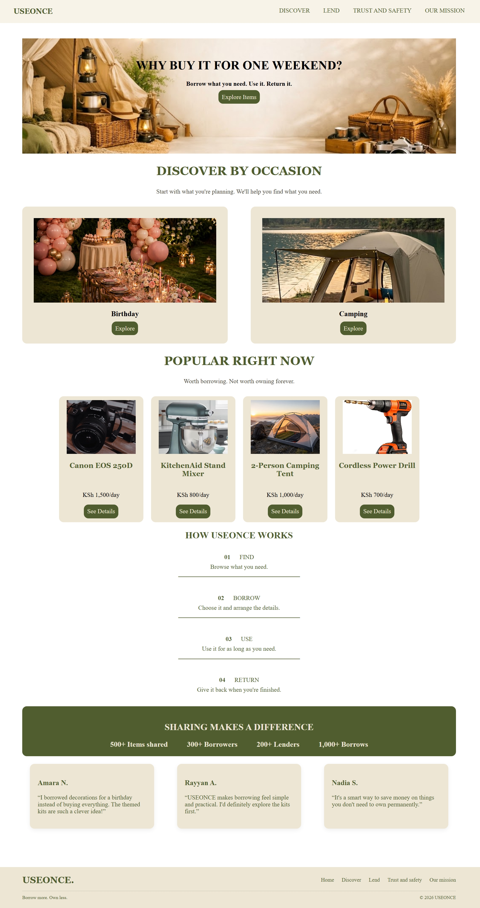

# USEONCE

**Need it. Use it. Return it.**

## About the Project

USEONCE is a website concept that encourages people to borrow items they need temporarily instead of purchasing things they may only use once or occasionally.

The platform aims to make borrowing and lending useful items more convenient, affordable, and sustainable.

## The Problem

People often spend money purchasing items they only need for a short period, such as cameras, camping equipment, party decorations, and kitchen appliances. These items may remain unused after their intended purpose.

USEONCE explores an alternative by allowing people to discover items they could borrow rather than buy.

## Target Audience

- People who need items for occasional use.
- Students and individuals looking for affordable alternatives to buying.
- People who own items they would like to lend to others.
- People interested in sharing resources and reducing unnecessary purchases.

## Project Goals

- Encourage borrowing instead of purchasing occasionally used items.
- Present available items through a clear, organized layout.
- Display item details and daily rental prices.
- Introduce themed kits for celebrations and outdoor activities.
- Demonstrate a simple borrowing journey.
- Promote responsible borrowing, lending, and returning.

## Pages and Features

### 1. Home Page (`index.html`)

- Introduces the USEONCE concept.
- Features a hero section encouraging visitors to explore items.
- Includes a Discover by Occasion section.
- Displays popular items.
- Explains the borrowing process through a How It Works section.
- Includes navigation and footer links.

### 2. Explore Items (`explore.html`)

- Displays items available to borrow.
- Uses item cards with images, names, and daily rental prices.
- Features individual items and themed kits.
- Provides a starting point for visitors to explore available options.

### 3. Item Details (`item-details.html`)

- Presents information about selected items and kits.
- Includes descriptions and daily rental prices.
- Features a Celebration Kit and a Camping Kit.
- Includes a Borrow button leading to the confirmation page.

### 4. List an Item (`list-item.html`)

- Provides a form layout for people who want to lend their items.
- Includes fields for item name, category, description, condition, rental price, location, and photo upload.
- Includes categories such as Electronics & Photography, Kitchen & Appliances, Camping & Outdoors, Tools & DIY, and Other.

### 5. Borrow Confirmation (`borrow-confirmation.html`)

- Presents a confirmation-style screen for the borrowing journey.
- Uses visual confirmation elements and icons.
- Organizes information around the selected item, collection, and return.

### 6. Trust and Safety (`Trust-and-safety.html`)

- Introduces the website's approach to responsible borrowing and lending.
- Emphasizes trust, confidence, and returning borrowed items responsibly.

### 7. Our Mission (`Our-mission.html`)

- Explains the purpose behind USEONCE.
- Communicates the idea that access to useful items can matter more than ownership.
- Uses images and content to support the project's mission.

## Design and Style Guide

USEONCE follows a warm, minimal design intended to feel welcoming and easy to navigate.

| Element | Design Choice |
|---|---|
| Primary colour | Olive green `#4F5D2F` |
| Background colour | Cream `#F7F3E8` |
| Card background | `#EDE6D5` |
| Border colour | `#D8D0BC` |
| Accent colour | Burgundy `#4F1622` |
| Heading and logo font | Georgia |
| Layout | Sections, item cards, navigation, and footer |
| Visual style | Minimal, warm, and consistent |

The website uses rounded cards, subtle borders, consistent typography, imagery, and icons to maintain a unified appearance across its pages.

## Technologies Used

- **HTML5:** Structures the website pages, content, navigation, and forms.
- **CSS3:** Styles the layouts, colours, typography, spacing, and visual states.
- **Font Awesome 4.7.0:** Provides icons.
- **Git and GitHub:** Used for version control and project hosting.

The project uses HTML and CSS without JavaScript or a backend.

## Design Decisions

### Themed Kits

Celebration and camping kits distinguish USEONCE from a website that lists only individual items. They allow visitors to explore collections of items suited to particular activities.

### Daily Rental Prices

Displaying daily prices helps visitors understand the intended cost of borrowing items.

### Consistent Visual Identity

A shared colour palette, typography, and card styling connect the different pages and create a consistent experience.

### Separate Item Details Page

Providing a dedicated details page allows visitors to learn more about an item before proceeding to the borrowing confirmation screen.

### Trust and Mission Pages

These pages communicate the project's values and emphasize responsible sharing.

## Challenges

- Maintaining consistent styling across multiple pages.
- Organizing navigation between pages.
- Designing clear item cards and detail sections.
- Demonstrating a borrowing journey using HTML and CSS alone.
- Balancing visual design with project requirements.

## Limitations

USEONCE is a front-end website prototype. It demonstrates the intended layout and user journey but is not a fully operational borrowing platform.

Forms and confirmation screens are visual demonstrations. Real payments, user accounts, booking management, and live inventory are not implemented.

## Future Improvements

- Add a backend to manage item listings and borrowing requests.
- Implement functional search and filtering.
- Introduce user accounts and borrowing history.
- Add secure payment processing.
- Implement real-time item availability and booking management.
- Improve accessibility and test responsiveness across different devices.

## Conclusion

USEONCE explores how a digital platform could help people access items they need without purchasing everything themselves. Through individual listings, themed kits, and a simple borrowing journey, the project demonstrates a practical concept built using HTML and CSS.

## Project Links

**GitHub Repository:**https://github.com/sabihaalalji/USEONCE .

**Live Website:** https://sabihaalalji.github.io/USEONCE/index.html.

## Screenshots

## Screenshots

